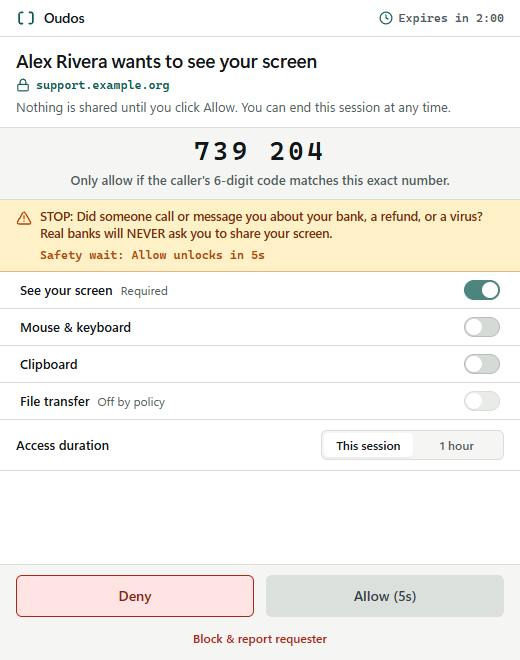
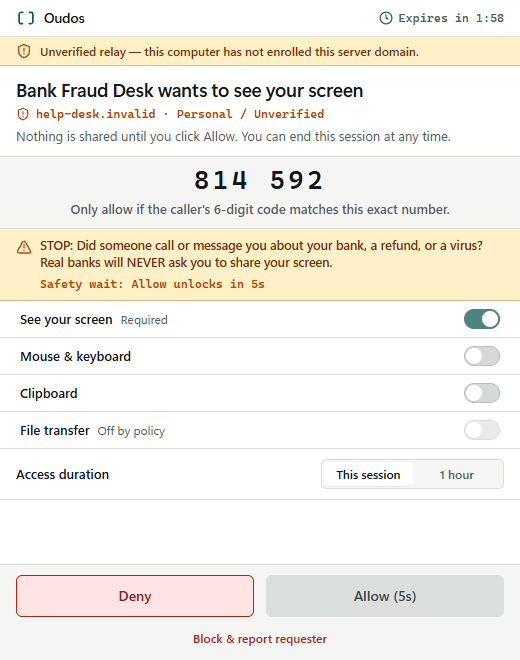
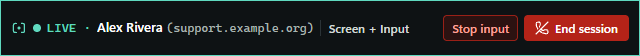
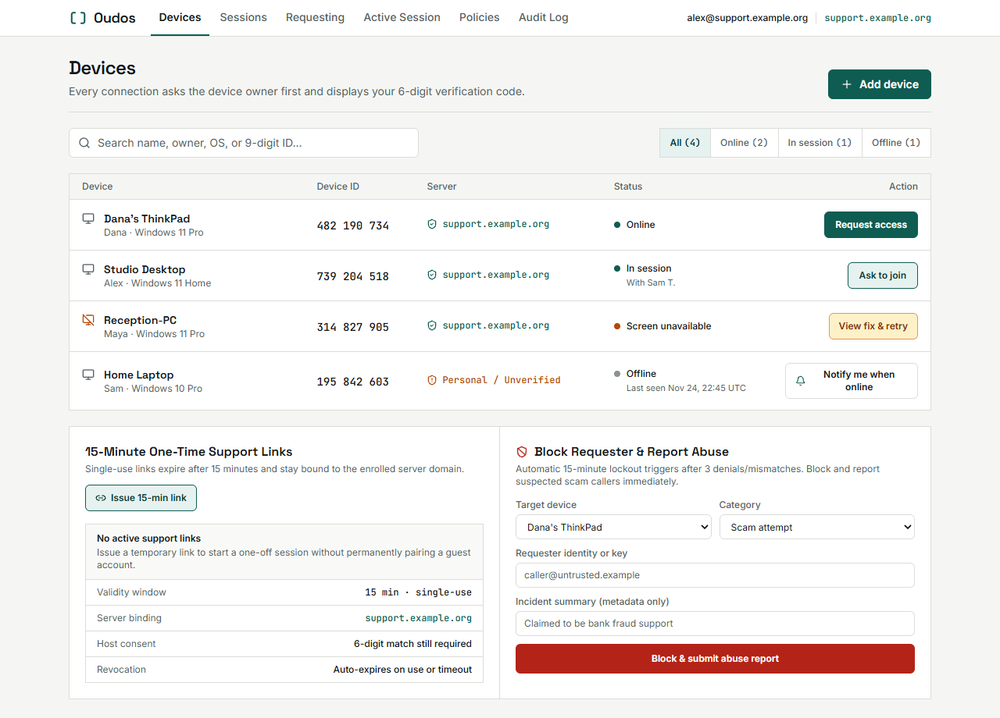
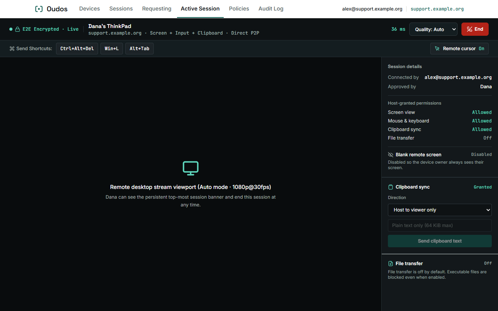

<p>
  <picture>
    <source media="(prefers-color-scheme: dark)" srcset="docs/assets/brand/oudos-mark-light.svg" />
    
  </picture>
</p>

# Oudos

**Oudos** (*Ancient Greek: οὐδός — "threshold / doorstep"*) is a Free and Open Source (**GNU AGPL-3.0**) consent-first remote desktop system designed to run and self-host on a **$0 infrastructure budget**.

> Nothing starts without the device owner's informed yes, every session is end-to-end encrypted, and every session is recorded in a tamper-evident audit log. Device owners can only make rules stricter, never looser.

**Current Status:** **`v0.1.0-rc.1` Pre-Release** — Automated protocol, host input-isolation, DPI, and WCAG 2.2 AA checks are complete. Real-world 5-tester 10-second consent comprehension validation ([Issue `#12`](PLAN.md), [`docs/USABILITY_TEST_SCRIPT.md`](docs/USABILITY_TEST_SCRIPT.md)) and final `v0.1.0` tagging remain open.

> [!NOTE]
> **Honest Security Posture:** Oudos is engineered to disrupt rushed phone-scam scripts, enforce host-side permissions, and preserve tamper-evident audit logs. No remote-access software can eliminate social engineering or claim to be "100% scam-proof." See [docs/THREAT_MODEL.md](docs/THREAT_MODEL.md) for the exact threat matrix and boundaries.

---

## Screenshots (`v0.1.0-rc.1`)

| Host Consent Card (Enrolled Server) | Host Consent Card (Unverified Relay) |
| :---: | :---: |
|  |  |
| *Enrolled domain chip (`support.example.org`), local 6-digit SAS (`739 204`), 5-second anti-scam cooling-off, screen-only defaults.* | *Explicit amber `Personal / Unverified` warning when a relay domain key is not enrolled on the host.* |

### Persistent Host Banner (Always-on-Top)



*Stays visible above all windows during every active session (`#0E1214` / `#5FD9BF`) with local-input-only `Stop input` and `End session` controls.*

### Self-Hosted Web Console (`apps/web-pwa`)



*Devices registry, 15-minute single-use support links, and requester block/report controls—100% free and self-hostable.*



*Obsidian dark active session viewer (`#0E1214`) displaying host-granted permissions, `36 ms` telemetry, and `Blank remote screen: Disabled`.*

---

## How Oudos Differs

| Capability | Typical Remote Desktop Tools | Oudos (`v0.1`) |
| :--- | :--- | :--- |
| **Consent Model** | Unattended passwords or full-control defaults common | **Strictly Asks-First:** No unattended mode, no `"Until I turn it off"` grants; screen-view only by default (`mouse_keyboard`, `clipboard_sync`, `file_transfer` start OFF) |
| **Anti-Coercion Cooling-Off** | Immediate one-click accept | **5-second disabled `Allow`** + plain-English bank/refund/virus scam warning for first-time requesters |
| **Anti-Spoofing & Code Match** | Server-generated PINs or unpinned relay labels | **Pre-paired server key enrollment** with raw domain chip (or amber `Personal / Unverified`) + **locally derived 6-digit SAS** (`HKDF-SHA256` commit-before-reveal; server never sees the code) |
| **Input & Prompt Protection** | Remote pointer can often interact with host UI | **Host-enforced `SessionGrant` gatekeeper** + Win32 `LLMHF_INJECTED`/`LLKHF_INJECTED` rejection + remote pointer rect blocking over consent/banner windows |
| **Screen Blanking** | Supported ("curtain mode") on host | **Explicitly disabled** in `v0.1` so device owners always see what happens on their screen |
| **Self-Hosting & Licensing** | Proprietary server or paywalled audit/policy tiers | **100% GNU AGPL-3.0:** 1-command `docker compose up` includes device registry, 15-minute support links, monotonic `Org -> Group -> Owner` policies, and SHA-256 hash-chained CSV audit logs |

---

## Core Architecture & Guarantees

- **Host-Enforced Gatekeeper (`crates/oud-capture`):** Capabilities (`view_screen`, `mouse_keyboard`, `clipboard_sync`, `file_transfer`) live in an Ed25519 host-signed `SessionGrant`. Unchecked input, clipboard, or file frames are dropped locally at the host protocol boundary before touching OS APIs.
- **Handshake-Derived 6-Digit SAS (`crates/oud-protocol`):** Derived locally on both peers via `HKDF-SHA256(transcript_hash, "oudos-sas-v1")` after commit-before-reveal X25519 + Ed25519 authentication.
- **Monotonic Policy Engine (`crates/oud-policy`):** Merges `Organisation -> Group -> Device Owner` using logical `AND` for allow-flags and `min()` for numeric caps. Owners can only tighten rules, never relax them.
- **Tamper-Evident Audit Log:** Metadata-only (zero pixels, keystrokes, clipboard text, or file contents), host-signed, and SHA-256 hash-chained (`H_n = SHA-256(H_{n-1} || CanonicalJSON(Event_n))`) with CSV export.

---

## Quick Start

### 1. Self-Host the Control Plane & Web Console (Under 3 Minutes)

Every feature in the web console, control plane, policy engine, and audit log is free and self-hostable via [deploy/docker-compose.yml](deploy/docker-compose.yml) (see [docs/SELF_HOSTING.md](docs/SELF_HOSTING.md)):

```bash
cp .env.example deploy/.env
docker compose -f deploy/docker-compose.yml up -d --build
curl -fsS http://localhost:8080/health
```

Open `http://localhost:8080` for the web PWA console. Optional profiles:
- `--profile tls` — Automatic HTTPS via Caddy (`OUD_SERVER_DOMAIN` required)
- `--profile coturn` — Self-hosted TURN relay fallback (default is `$0` direct P2P WebRTC with public STUN; Cloudflare Realtime TURN free tier is also supported)

### 2. Local Development & Full Verification

**Prerequisites:** Rust stable (`rustfmt`, `clippy`), Node.js 22+, `pnpm` (`corepack enable`), and Windows 10/11 for the Tauri v2 host agent.

```powershell
# Install JS workspace dependencies
pnpm install --frozen-lockfile

# Root Rust workspace (protocol, policy, capture, server)
cargo fmt --all -- --check
cargo clippy --workspace --all-targets -- -D warnings
cargo test --workspace

# Standalone Windows Tauri v2 host agent
cargo fmt --manifest-path apps/host-desktop/src-tauri/Cargo.toml --all -- --check
cargo clippy --manifest-path apps/host-desktop/src-tauri/Cargo.toml --all-targets -- -D warnings
cargo test --manifest-path apps/host-desktop/src-tauri/Cargo.toml
cargo build --manifest-path apps/host-desktop/src-tauri/Cargo.toml --bin oud-host-desktop

# Frontend typecheck, build, accessibility (Vitest + axe-core), and Playwright E2E
pnpm typecheck
pnpm build
pnpm --dir apps/host-desktop run test
pnpm --dir apps/web-pwa run test
pnpm --dir apps/web-pwa run test:e2e
```

---

## Windows Code Signing & Checksums

- Reproducible Windows `.msi` / NSIS installers are built on `windows-latest` by [release-builds.yml](.github/workflows/release-builds.yml) alongside `SHA256SUMS-windows.txt`.
- Free open-source Windows code signing via **SignPath Foundation** is planned once `v0.1.0` is tagged and published. Until SignPath onboarding completes, always verify `SHA256SUMS-windows.txt` before running `v0.1.0-rc.1` pre-release binaries.

---

## Monorepo Layout

- `crates/oud-protocol` — Ed25519 identity keys, X25519 handshake, SAS derivation, `SessionGrant`, consent state machine, hash-chain audit primitives.
- `crates/oud-policy` — Monotonic `Org -> Group -> Owner` policy merger.
- `crates/oud-capture` — Windows DXGI/GDI screen capture, H.264 pipeline, `webrtc-rs` transport, input isolation, clipboard/file transfer, and host gatekeeper.
- `crates/oud-server` — Self-hostable Axum control plane, signaling, rate limits, 15-minute support links, and audit API.
- `apps/web-pwa` — React + TypeScript + Tailwind PWA viewer and admin console.
- `apps/host-desktop` — Tauri v2 Windows host agent, protected consent UI, tray icons, and persistent banner.
- `apps/mobile-capacitor` — Capacitor mobile wrapper (`v0.2+`).
- `deploy/` — `docker-compose.yml`, Dockerfiles, Nginx, Caddy, and `coturn` configuration.

---

## Documentation

- [Design System & Brand Guide (`DESIGN.md`)](DESIGN.md)
- [Threat Model (`docs/THREAT_MODEL.md`)](docs/THREAT_MODEL.md)
- [10-Second Usability Test Script (`docs/USABILITY_TEST_SCRIPT.md`)](docs/USABILITY_TEST_SCRIPT.md)
- [Consent UX Specification (`docs/CONSENT_UX_SPEC.md`)](docs/CONSENT_UX_SPEC.md)
- [Architecture (`docs/ARCHITECTURE.md`)](docs/ARCHITECTURE.md)
- [Protocol & Cryptography (`docs/PROTOCOL.md`)](docs/PROTOCOL.md)
- [Self-Hosting Guide (`docs/SELF_HOSTING.md`)](docs/SELF_HOSTING.md)
- [Locked Decisions (`docs/DECISIONS.md`)](docs/DECISIONS.md)
- [Implementation Roadmap (`PLAN.md`)](PLAN.md)
- [Changelog (`CHANGELOG.md`)](CHANGELOG.md)
- [Security & Anti-Abuse Policy (`.github/SECURITY.md`)](.github/SECURITY.md)

## License

Licensed under **GNU AGPL-3.0** (`AGPL-3.0-only`). See [LICENSE](LICENSE).
